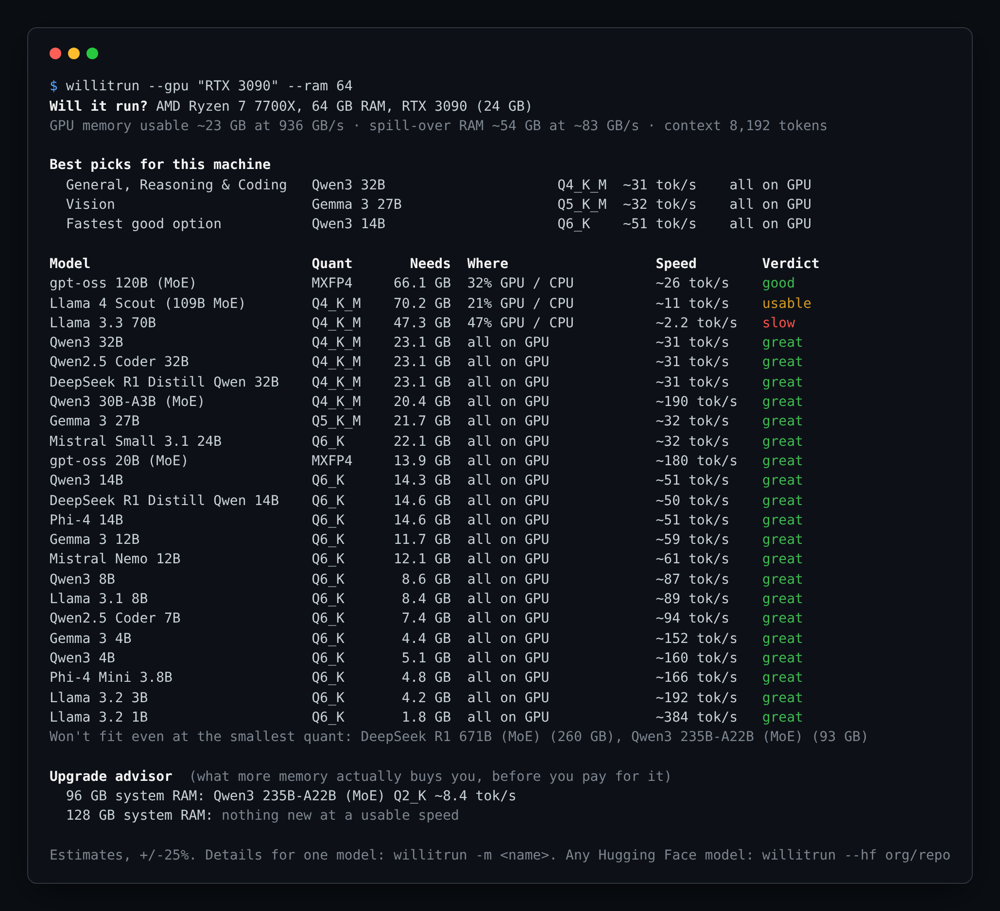
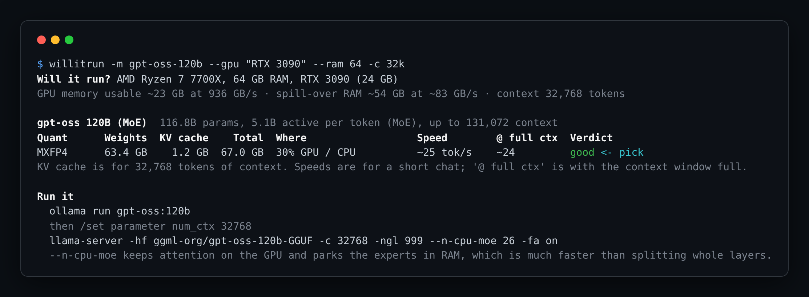

# willitrun

**Which open LLMs will actually run on your machine, at what quantization, and how fast?**

One command reads your RAM, GPU and memory bandwidth, then tells you the best model for chat, reasoning, coding and vision, where it will live (GPU, split, or CPU), and the speed you can expect. Then it hands you the exact `ollama` or `llama.cpp` command to run it.

```
pip install willitrun
willitrun
```



No dependencies. Python 3.9+. Works on macOS (Apple Silicon), Linux and Windows with NVIDIA, AMD, Intel Arc, Strix Halo, DGX Spark, or no GPU at all.

## Why another "can I run it" tool?

Most calculators take parameter count times bits and compare it to your VRAM. That answer is often wrong in ways that matter:

| Problem with the simple math | What willitrun does |
|---|---|
| Ignores the **KV cache**, which grows with context. A 32B model that fits at 4k context spills out of a 24 GB card at 32k. | Computes the cache per model from its real architecture (layers, KV heads, head size), including **sliding-window** layers (Gemma 3, gpt-oss, Llama 4) and DeepSeek's compressed MLA cache. Pass `--ctx 32k` to plan for long documents or coding agents. |
| Says "won't fit" when the model is too big for VRAM, even though it would run fine split across GPU and RAM. | Plans **partial offload** and estimates the speed of the split. Tells you the exact `-ngl` layer count. |
| Treats **MoE** models like dense ones. gpt-oss-120b has 117B parameters but reads only ~5B per token. | Speed uses **active** parameters, and for split setups it models **expert offload** (`--n-cpu-moe`): attention stays on the GPU and only the experts sit in RAM. That's why a 120B model can do 25 tok/s on a gaming PC. |
| Gives a fit/no-fit, not a speed. | Estimates tokens/sec from **memory bandwidth**, the real bottleneck for generation, with a separate number for when the context is full. |
| Ignores the **macOS GPU memory cap** (~75% of unified memory). | Flags models that need the cap raised and prints the `sysctl` command. |
| Can't tell you whether an upgrade is worth it. | The **upgrade advisor** shows what more RAM or a different GPU would actually unlock. With 2026 RAM prices, know before you buy. |
| Only knows the models in its list. | `--hf org/repo` reads **any Hugging Face model's** `config.json` and checks it. |

## Usage

```bash
willitrun                                  # this machine vs. ~25 popular open models
willitrun -m qwen3-30b-a3b                 # one model: every quant, longest context, run commands
willitrun --ctx 32k                        # plan for long context
willitrun --kv-cache q8_0                  # halve the KV cache (small quality cost)
willitrun --tag coding                     # only coding models
willitrun --hf mistralai/Devstral-Small-2505   # anything on Hugging Face
willitrun --json                           # for scripts and dashboards
```

**Try hardware before you buy it.** Every detected value can be overridden:

```bash
willitrun --gpu "RTX 5090" --ram 64
willitrun --gpu "RTX 3090" --gpu-count 2 --ram 128
willitrun --gpu "M4 Max" --ram 128
willitrun --gpu "Ryzen AI Max" --ram 128     # Strix Halo mini PCs
willitrun --gpu none --ram 32 --ram-bw 50    # CPU only, DDR4
willitrun --list-gpus                        # the built-in bandwidth table
```



## How the estimates work

**Memory** = weights + KV cache + runtime buffers.

- Weights use the measured bits-per-weight of each GGUF format (Q4_K_M is ~4.85, not 4, because of block scales).
- KV cache = context × layers × 2 × KV heads × head size × bytes per element, with sliding-window layers capped at their window.
- About 0.7 GB per GPU is held back for the driver and display. macOS lets the GPU wire ~67% of RAM (75% above 36 GB). On a CPU-only or split setup, 15% of RAM (at least 4 GB) is left for the OS.

**Speed.** Generating a token streams the active weights (plus the KV cache) through memory once, so:

```
ms per token = GPU bytes / (GPU bandwidth × efficiency) + CPU bytes / (RAM bandwidth × efficiency) + fixed overhead
```

Efficiency factors were fitted to published llama.cpp results:

| Machine | Model | Reference | willitrun |
|---|---|---|---|
| RTX 4090 | Llama 3.1 8B Q4_K_M | ~130 tok/s | 124 |
| RTX 3090 | Llama 3.1 8B Q4_K_M | ~112 | 116 |
| RTX 4090 | Qwen3 30B-A3B Q4_K_M | ~175 | 201 |
| 2× RTX 3090 | Llama 3.3 70B Q4_K_M | ~17 | 15 |
| M2 Ultra | Llama 3.1 8B Q4_K_M | ~80 | 74 |
| M1 Max | Llama 3.1 8B Q4_K_M | ~50 | 49 |
| M3 Max | Llama 3.3 70B Q4_K_M | ~7 | 6 |
| DDR5 desktop, CPU only | Llama 3.1 8B Q4_K_M | ~11 | 10 |

Reference numbers are typical community `llama-bench` results, rounded. They live in [`tests/test_calibration.py`](tests/test_calibration.py) and CI fails if an estimate drifts more than 30% from them. Expect ±25% on your own machine. Prompt processing (time to first token) is not modeled yet.

**Picking a quant.** Start at Q4_K_M. Step up to Q5/Q6 only while it stays fully on the GPU and keeps at least 75% of Q4's speed. When a model has to spill into RAM, stay at Q4_K_M (or drop to Q3) because every extra bit costs speed you can't spare.

## Known limits

- RAM bandwidth can only be read on Windows, or on Linux as root (`dmidecode`). Otherwise it assumes dual-channel DDR5 (80 GB/s) and says so. Use `--ram-bw` to correct it.
- Unknown GPUs get 400 GB/s with a warning. Pass `--gpu-bw`, and please open a PR to add your card.
- Multi-GPU assumes llama.cpp's default layer split, so speed is bounded by the slowest card.
- "Best picks" rank by a simple size/recency/quant heuristic, not benchmarks. Treat them as a starting point.

## Contributing

Adding a model is one line in [`willitrun/catalog.py`](willitrun/catalog.py), with numbers copied from its `config.json`. Real-world speed reports (`llama-bench` output plus your hardware) are the most useful issue you can open, because they make the calibration better for everyone.

```bash
pip install -e ".[test]"
pytest
```

## License

MIT
