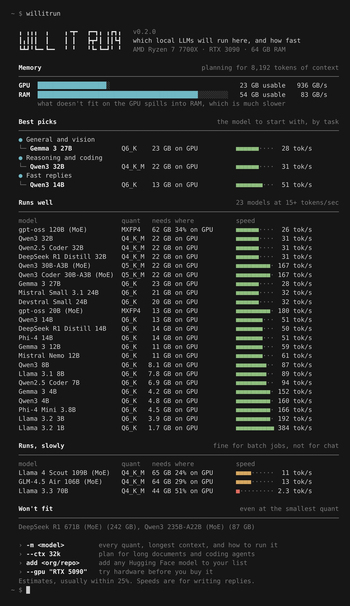
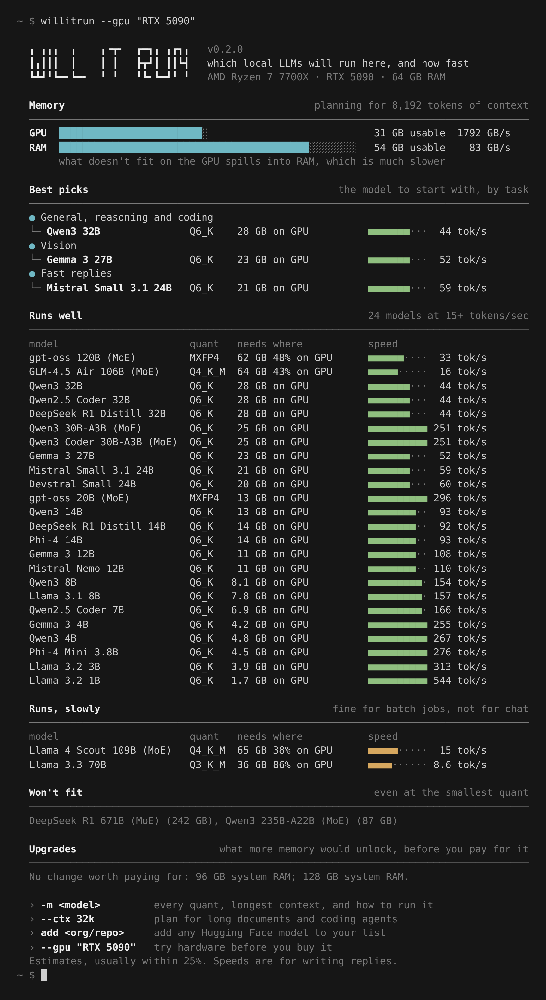

# willitrun

Which open LLMs will run on your machine, at what quantization, and how fast. One command, no dependencies.

```
pipx run --spec git+https://github.com/r0ottrek/willitrun willitrun
```



It reads your RAM, GPU and memory bandwidth, then for each model works out:

- the quantization worth using, and how much memory it needs at your context length
- where it runs: fully on the GPU, split between GPU and RAM, or on the CPU
- how many tokens per second to expect
- the `ollama` and `llama.cpp` commands to run it, with the right GPU layer split

It works on macOS (Apple Silicon), Linux and Windows. It detects NVIDIA cards everywhere, AMD cards on Linux, and AMD Strix Halo and NVIDIA DGX Spark unified memory. Anything it can't detect, such as an Intel Arc card, can be described with `--gpu`.

## Install

Python 3.9 or later. Any of these work; none needs an account anywhere.

```sh
pipx run --spec git+https://github.com/r0ottrek/willitrun willitrun   # run once, nothing installed
uvx --from git+https://github.com/r0ottrek/willitrun willitrun        # same, with uv
pip install git+https://github.com/r0ottrek/willitrun                 # then just: willitrun
```

On Windows, if `willitrun` isn't found after `pip install`, run `py -m willitrun` instead.

## Usage

```sh
willitrun                         # this machine against the built-in models
willitrun -m qwen3-30b-a3b        # one model: every quant, longest context, run commands
willitrun --ctx 32k               # plan for long documents and coding agents
willitrun --kv-cache q8_0         # halve the context memory, at a small quality cost
willitrun --tag coding            # only coding models
willitrun --json                  # for scripts
```

### Try hardware before you buy it

Every detected value can be overridden, so you can see what a GPU or a bigger Mac would do before paying for it. The overview also ends with what the next RAM or GPU step would unlock.

```sh
willitrun --gpu "RTX 5090" --ram 64
willitrun --gpu "RTX 3090" --gpu-count 2 --ram 128
willitrun --gpu "M4 Max" --ram 128
willitrun --gpu "Ryzen AI Max" --ram 128
willitrun --gpu none --ram 32 --ram-bw 50       # CPU only, DDR4
willitrun --list-gpus                           # the built-in table
```



### One model in detail


## Models

28 models are built in: current Llama, Qwen, Gemma, Mistral, Phi, gpt-oss, DeepSeek and GLM releases, from 1B to 671B. `willitrun models` lists them.

New models come out every week, so you can add any model on Hugging Face yourself. It reads the model's `config.json`, works out the architecture, and keeps the model in every scan after that:

```sh
willitrun add mistralai/Devstral-Small-2505 --tags coding
willitrun add ./my-finetune/config.json --params 8.2     # a local or private model
willitrun models                                         # yours are marked with *
willitrun remove devstral-small-2505
```

Gated models need `HF_TOKEN` set. To check a model once without saving it, use `--hf org/repo`. Your list is a JSON file in `~/.config/willitrun/` (`%APPDATA%\willitrun\` on Windows) in the same format as the built-in [models.json](willitrun/models.json). To add a model for everyone, add a line there and open a pull request.

## How the estimates work

Memory is weights plus KV cache plus runtime buffers.

- Weights use the real bits per weight of each GGUF format. Q4_K_M is about 4.85 bits, not 4, because of block scales.
- The KV cache is context × layers × 2 × KV heads × head size × bytes per value. Layers with a sliding window (Gemma 3, gpt-oss, Llama 4) only keep their window, and DeepSeek's compressed cache is counted as such. That's why the same model can fit at 8k context and spill at 32k.
- About 0.7 GB per GPU is left for the driver and display. macOS lets the GPU use about two thirds of memory, or three quarters above 36 GB. On the CPU side, 15% of RAM (at least 4 GB) is left for the system.

Speed comes from memory bandwidth, which is what limits text generation: each new token reads the active weights and the cache once.

```
ms per token = GPU bytes / (GPU bandwidth × efficiency) + RAM bytes / (RAM bandwidth × efficiency) + overhead
```

Mixture-of-experts models only read their active experts per token, which is why gpt-oss 120B is faster than a dense 32B. When an MoE model is too big for the GPU, the plan keeps attention and shared weights on the GPU and parks only experts in RAM (llama.cpp's `--n-cpu-moe`).

The efficiency factors were fitted to published llama.cpp results:

| Machine | Model | Reported | willitrun |
|---|---|---|---|
| RTX 4090 | Llama 3.1 8B Q4_K_M | about 130 tok/s | 124 |
| RTX 3090 | Llama 3.1 8B Q4_K_M | about 112 | 116 |
| RTX 4090 | Qwen3 30B-A3B Q4_K_M | about 175 | 201 |
| 2× RTX 3090 | Llama 3.3 70B Q4_K_M | about 17 | 15 |
| M2 Ultra | Llama 3.1 8B Q4_K_M | about 80 | 74 |
| M1 Max | Llama 3.1 8B Q4_K_M | about 50 | 49 |
| M3 Max | Llama 3.3 70B Q4_K_M | about 7 | 6 |
| DDR5 desktop, CPU only | Llama 3.1 8B Q4_K_M | about 11 | 10 |

The reported figures are typical community `llama-bench` results, rounded. They live in [tests/test_calibration.py](tests/test_calibration.py), and the tests fail if an estimate drifts more than 30% from them. Expect within about 25% on your own machine. Time to read a long prompt is not estimated.

The pick for each model starts at Q4_K_M and steps up to Q5 or Q6 only while the model stays on the GPU and keeps at least 75% of the Q4 speed. When a model has to spill into RAM, it stays at Q4_K_M or drops to Q3.

## Limits

- RAM speed is read on Windows, and on Linux when run as root. Otherwise it assumes dual-channel DDR5 at 80 GB/s and says so; pass `--ram-bw` to correct it.
- A GPU missing from the table gets 400 GB/s and a warning. Pass `--gpu-bw`, and a pull request adding the card is welcome.
- With several GPUs it assumes llama.cpp's default layer split, so the slowest card sets the pace.
- Best picks are ranked by size, release year and quantization, not by benchmark scores.

## Development

```sh
git clone https://github.com/r0ottrek/willitrun
cd willitrun
pip install -e ".[test]"
pytest
python scripts/demo/screens.py && node scripts/demo/render.mjs   # rebuild docs/*.png
```

Real speed reports are the most useful issue you can open: your `llama-bench` output plus what `willitrun --json` says about your machine.

## License

MIT
